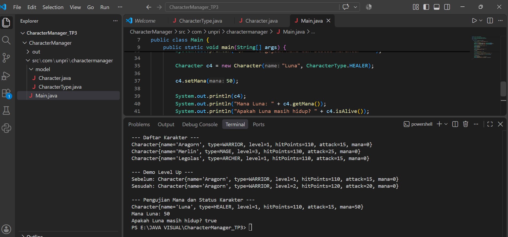

# Character Manager — TP3 (Java Visual SIH-6406)

## Deskripsi

Character Manager adalah program sederhana berbasis Java untuk mengelola karakter game. Program ini menerapkan konsep Object-Oriented Programming (OOP), seperti class, object, constructor, encapsulation, getter, setter, dan method. Program juga memiliki fitur pengelolaan mana dan pemeriksaan status kehidupan karakter.

## Fitur Program

- Membuat karakter dengan tipe WARRIOR, MAGE, ARCHER, dan HEALER.
- Menggunakan dua constructor.
- Mengatur level karakter.
- Menghitung hitPoints dan attack berdasarkan level.
- Menaikkan level menggunakan method `levelUp()`.
- Mengatur mana menggunakan `getMana()` dan `setMana()`.
- Memvalidasi agar mana tidak bernilai negatif.
- Memeriksa status kehidupan menggunakan `isAlive()`.
- Menampilkan informasi karakter menggunakan `toString()`.

## Struktur Folder

```text
CharacterManager_TP3/
├── CharacterManager/
│   ├── src/
│   │   └── com/
│   │       └── unpri/
│   │           └── charactermanager/
│   │               ├── Main.java
│   │               └── model/
│   │                   ├── Character.java
│   │                   └── CharacterType.java
│   └── output-program.png
├── README.md
└── .gitignore
```

## Screenshot Output Program

## Screenshot Output Program



Screenshot menampilkan daftar tiga karakter, demo kenaikan level, pengaturan mana, dan hasil pemeriksaan `isAlive()`.

## Identitas Mahasiswa

- **Nama:** Putri Delimayanti Sumbayak
- **NIM:** 253303621223
- **Program Studi:** Sistem Informasi
- **Universitas:** Universitas Prima Indonesia
- **Mata Kuliah:** Java Visual (SIH-6406)

## Link Google Docs — Bagian D
https://docs.google.com/document/d/11kVQw9YRiQe1fcBRXk29dbwwZlcLTm3Jvoy2UIiG94k/edit?usp=sharing
