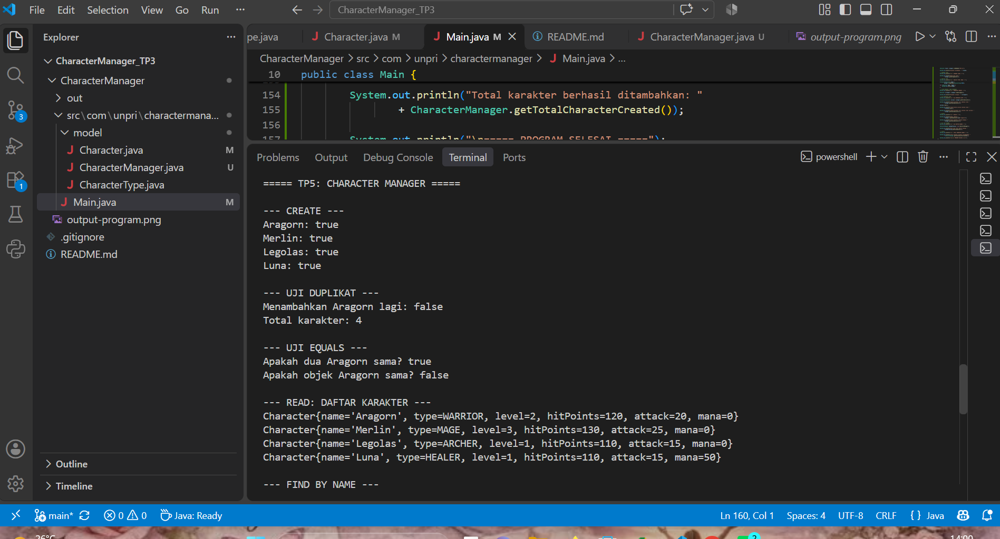
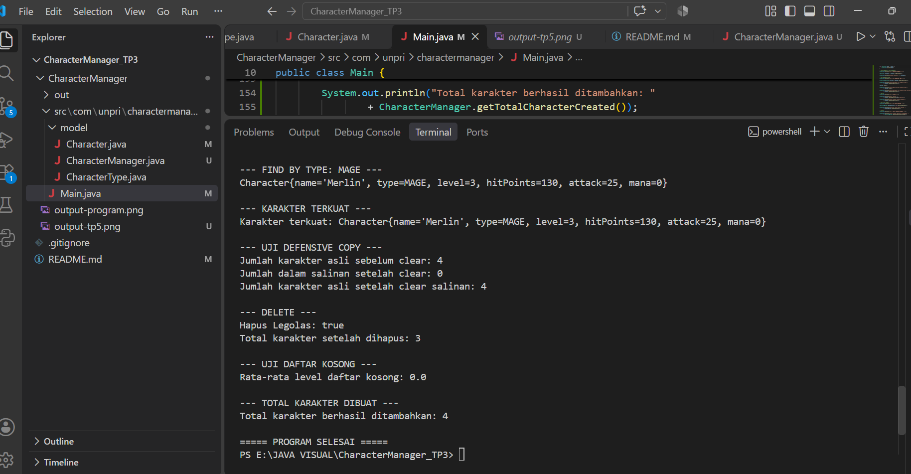
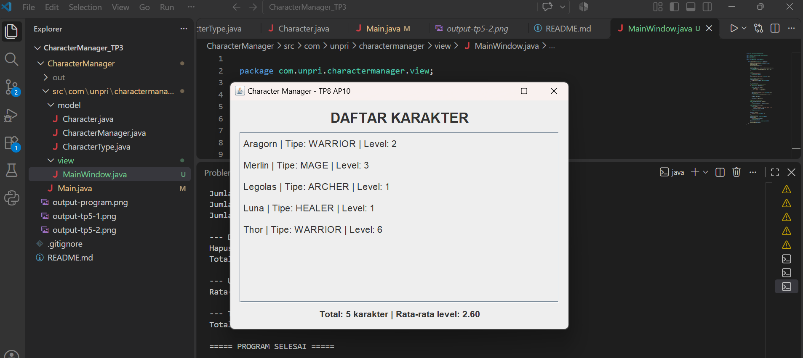
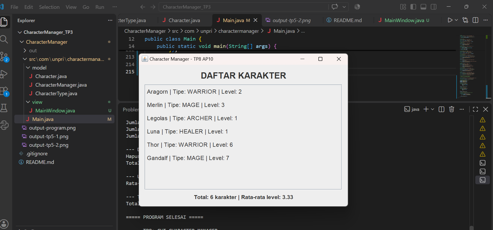

# Character Manager — TP3 (Java Visual SIH-6406)

## Deskripsi

Character Manager adalah program sederhana berbasis Java untuk mengelola karakter game. Program ini menerapkan konsep Object-Oriented Programming (OOP), seperti class, object, constructor, encapsulation, getter, setter, dan method. Program juga memiliki fitur pengelolaan mana dan pemeriksaan status kehidupan karakter.

## Fitur Program

- Membuat karakter dengan tipe WARRIOR, MAGE, ARCHER, dan HEALER.
- Menggunakan dua constructor.
- Mengatur level karakter.
- Menghitung hitPoints dan attack berdasarkan level.
- Menaikkan level menggunakan method `levelUp()`.
- Mengatur mana menggunakan `getMana()` dan `setMana()`.
- Memvalidasi agar mana tidak bernilai negatif.
- Memeriksa status kehidupan menggunakan `isAlive()`.
- Menampilkan informasi karakter menggunakan `toString()`.

## Struktur Folder

```text
CharacterManager_TP3/
├── CharacterManager/
│   ├── src/
│   │   └── com/
│   │       └── unpri/
│   │           └── charactermanager/
│   │               ├── Main.java
│   │               └── model/
│   │                   ├── Character.java
│   │                   └── CharacterType.java
│   └── output-program.png
├── README.md
└── .gitignore
```

## Screenshot Output Program

## Screenshot Output Program


Screenshot menampilkan daftar tiga karakter, demo kenaikan level, pengaturan mana, dan hasil pemeriksaan `isAlive()`.

## Identitas Mahasiswa

- **Nama:** Putri Delimayanti Sumbayak
- **NIM:** 253303621223
- **Program Studi:** Sistem Informasi
- **Universitas:** Universitas Prima Indonesia
- **Mata Kuliah:** Java Visual (SIH-6406)

## Link Google Docs — Bagian D
https://docs.google.com/document/d/11kVQw9YRiQe1fcBRXk29dbwwZlcLTm3Jvoy2UIiG94k/edit?usp=sharing

---
# TP5 — Character Manager Sprint #2

## Deskripsi TP5

TP5 merupakan pengembangan dari proyek TP3. Pada tahap ini, program dilengkapi dengan fitur pengelolaan data karakter menggunakan ArrayList, analisis level, pencarian berdasarkan tipe, serta pengujian object reference.

## Fitur TP5

### Part A — Character Manager

- Menambahkan karakter menggunakan `addCharacter()`.
- Mencari karakter berdasarkan nama menggunakan `findByName()`.
- Menghapus karakter menggunakan `removeCharacter()`.
- Menghitung jumlah karakter menggunakan `getTotalCharacters()`.
- Mengembalikan salinan daftar karakter menggunakan `getAllCharacters()`.
- Menggunakan `equals()` untuk membandingkan karakter berdasarkan nama.
- Menolak penambahan karakter dengan nama duplikat.

### Part B — Analytics

- Menghitung rata-rata level menggunakan `getAverageLevel()`.
- Mencari karakter berdasarkan tipe menggunakan `findByType()`.
- Menggunakan atribut static untuk menghitung jumlah karakter yang berhasil ditambahkan.

### Part C — Fitur Mandiri

Fitur tambahan yang dibuat adalah `findStrongest()`.

Method ini digunakan untuk mencari karakter dengan nilai attack tertinggi dari seluruh karakter yang tersimpan. Jika daftar karakter kosong, method mengembalikan `null`.

Fitur ini membantu pengguna mengetahui karakter yang memiliki kekuatan serangan paling tinggi.

## Screenshot Output TP5

### Screenshot 1 — Pengujian CRUD dan Analytics



### Screenshot 2 — Find Strongest, Defensive Copy, dan Pengujian Object Reference



Screenshot menampilkan hasil pengujian fitur Character Manager TP5, termasuk penambahan karakter, penolakan duplikat, equals, object reference, analytics, findStrongest, defensive copy, dan penghapusan karakter.

## Link Google Docs TP5 — Bagian D

https://docs.google.com/document/d/1lJy19MVq7iY5ljzIRNj-N8Visfn0v4yWNbvMsK9RAxE/edit?usp=sharing

---

# TP8 — Character Manager Sprint #3

## Deskripsi TP8

TP8 merupakan pengembangan lanjutan dari proyek Character Manager dengan menerapkan konsep Graphical User Interface (GUI) menggunakan Java Swing. Program menampilkan daftar karakter secara dinamis melalui jendela aplikasi serta menyediakan informasi jumlah karakter dan rata-rata level.

## Part A — GUI Character Manager

Fitur yang dikembangkan:

- Membuat jendela aplikasi menggunakan `JFrame`.
- Menampilkan judul aplikasi Character Manager.
- Menampilkan daftar karakter menggunakan `JLabel`.
- Menggunakan `JPanel` untuk mengatur tata letak komponen.
- Menggunakan `JScrollPane` agar daftar karakter dapat digulir.
- Menampilkan data karakter secara dinamis menggunakan perulangan.
- Menjalankan GUI menggunakan `SwingUtilities.invokeLater()`.

## Part B — Penambahan Karakter dan Statistik

Program menampilkan enam karakter:

1. Aragorn — WARRIOR
2. Merlin — MAGE
3. Legolas — ARCHER
4. Luna — HEALER
5. Thor — WARRIOR
6. Gandalf — MAGE

Dua karakter baru yang ditambahkan adalah:

- **Thor:** Karakter bertipe WARRIOR dengan level 6.
- **Gandalf:** Karakter bertipe MAGE dengan level 7.

Program juga menampilkan jumlah seluruh karakter dan rata-rata level karakter secara otomatis.

## Screenshot Output TP8

### Screenshot 1 — Sebelum Penambahan Karakter Kedua



### Screenshot 2 — Setelah Penambahan Karakter



Kedua screenshot memperlihatkan perubahan jumlah karakter dan statistik rata-rata level setelah penambahan karakter.

## Alur Program dan Konsep MVC

Alur program dimulai dari `Main.java` yang membuat data karakter dan mengirimkannya kepada `CharacterManager` untuk dikelola. Selanjutnya, `MainWindow` menerima daftar karakter tersebut dan menampilkannya menggunakan komponen Java Swing. `CharacterManager` berperan sebagai bagian dari Model yang mengelola data karakter, sedangkan `MainWindow` berperan sebagai View yang bertanggung jawab menampilkan informasi kepada pengguna. Dengan demikian, pengelolaan data dan tampilan program dipisahkan agar struktur aplikasi lebih terorganisasi.

## Link Google Docs TP8 — Bagian D

https://docs.google.com/document/d/1mUmBmheenbeDq7eyYeXH-17PNsdARNqkBXfacjIZFLU/edit?usp=sharing